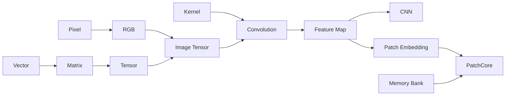

# Concept Dependency Graph

> Draft / Independent Reviewer PENDING. JSON 노드 483, 직접 간선 661. 생성 시 JS Kahn 위상정렬 483/483 처리 및 없는 선수 참조 0, 순환 0 검사. 별도 Python 실행은 미실시.

## 관계 정의

`A → B`는 B를 제대로 이해하려면 A를 먼저 알아야 한다는 **직접 선수 관계**다. 번호대로 읽는 추천 순서는 별도 `learning_paths` 이며 DAG와 동일하지 않다. `next_topics`는 `prerequisites`에서 역계산한 연결이다.



이는 대표 간선만 그린 개략도다. Dot Product, Local Connectivity, Shape·Stride·Padding·Activation 등 나머지 필수 의존은 JSON이 정본이다.

## 분야별 선수 Gate

| 핵심 개념 | 필수 선행 예시 | 학습상 의미 |
|---|---|---|
| `cnn.convolution` | `cnn.kernel`, `img.image_tensor`, `f.dot_product` | 2D/다중 채널 지역 가중합 |
| `cnn.feature_map` | `cnn.convolution`, `cnn.convolution_output_shape` | 위치별 출력과 Shape |
| `cnn.cnn_architecture` | `cnn.feature_hierarchy`, `dl.relu`, `dl.fully_connected_layer` | 특징 추출에서 분류 Head로 |
| `ad.patchcore` | `ad.patch_embedding`, `ad.memory_bank`, `ad.nearest_neighbor_search` | 표현·검색·거리 이상 점수 |
| `vid.temporal_transformer` | `vid.self_attention`, `vid.positional_encoding`, `vid.cnn_feature_sequence` | 시간적 위치와 Feature Sequence |
| `geom.ellipse_fitting` | `geom.ellipse_geometry`, `geom.least_squares` | 곡선 모델과 피팅 목적 |
| `ts.baseline_freeze` | `ts.baseline_update`, `ts.persistence_rule` | 변화 후보의 기준선 오염 회피 |
| `ops.triton_inference_server` | `ops.onnx_runtime`, `ops.batch_inference` | 모델 추론 형식과 처리 |

## 검증 및 한계

```bash
python scripts/validate_concept_graph.py
```

ID 유일성, 선수 ID 존재, 자기 참조, 중복 간선, Cycle, 역인덱스, 경로 ID를 확인한다. **DAG PASS는 교육학적 선수지식의 타당성 PASS가 아니다.** 초기 PART 공통 Anchor의 필수성, 같은 개념의 다른 분야 표기, 누락된 파생 개념은 독립 리뷰 대상이다.

MAD(Median Absolute Deviation)와 MAE(Mean Absolute Error)는 혼동하지 않는다. Ellipse Fitting은 해법에 따라 닫힌해/반복해/강건 추정이 다르며, '항상 닫힌해'나 '동일 입력이면 모든 환경에서 동일 결과'라는 일반화는 금지.
